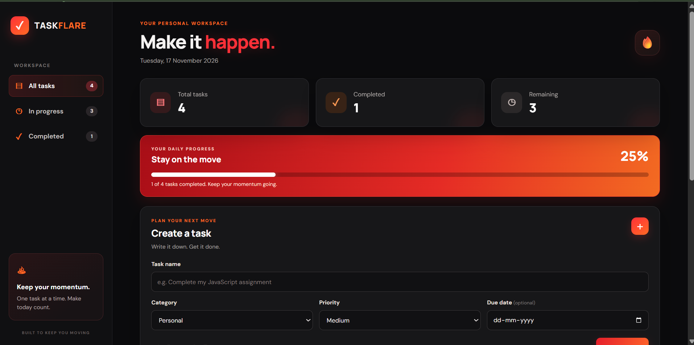
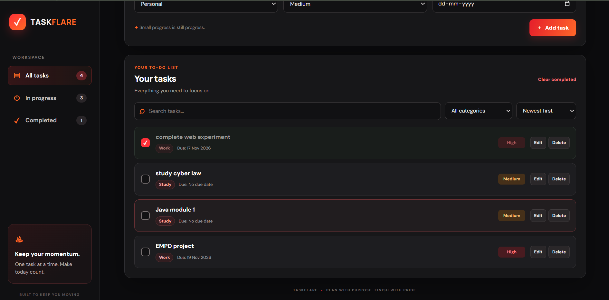
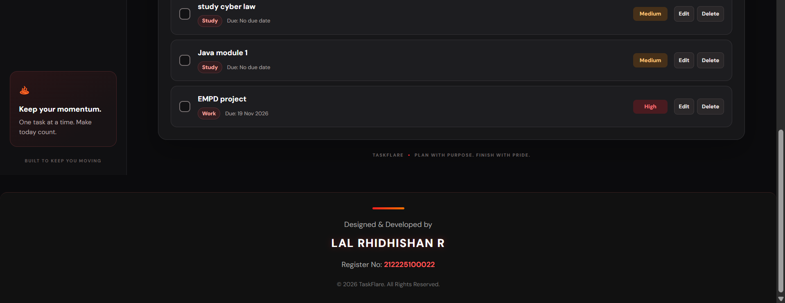

# Ex03 To-Do List using JavaScript

## AIM
To create a To-do Application with all features using JavaScript.

## ALGORITHM
### STEP 1
Build the HTML structure (index.html).

### STEP 2
Style the App (style.css).

### STEP 3
Plan the features the To-Do App should have.

### STEP 4
Create a To-do application using Javascript.

### STEP 5
Add functionalities.

### STEP 6
Test the App.

### STEP 7
Open the HTML file in a browser to check layout and functionality.

### STEP 8
Fix styling issues and refine content placement.

### STEP 9
Deploy the website.

### STEP 10
Upload to GitHub Pages for free hosting.

## PROGRAM

### HTML
```
<!DOCTYPE html>
<html lang="en">
<head>
  <meta charset="UTF-8">
  <meta name="viewport" content="width=device-width, initial-scale=1.0">
  <meta name="theme-color" content="#0b0b0d">
  <title>TaskFlare — Todo Application</title>
  <link rel="preconnect" href="https://fonts.googleapis.com">
  <link rel="preconnect" href="https://fonts.gstatic.com" crossorigin>
  <link href="https://fonts.googleapis.com/css2?family=DM+Sans:wght@400;500;600;700;800&family=Manrope:wght@500;600;700;800&display=swap" rel="stylesheet">
  <link rel="stylesheet" href="style.css">
  <script src="script.js" defer></script>
</head>
<body>
  <div class="app-shell">
    <aside class="sidebar">
      <a class="brand" href="#top" aria-label="TaskFlare home">
        <span class="brand-mark" aria-hidden="true">✓</span>
        <span class="brand-name">TASK<span>FLARE</span></span>
      </a>

      <div class="sidebar-label">WORKSPACE</div>
      <nav class="side-nav" aria-label="Task filters">
        <button class="nav-link is-active" type="button" data-filter="all" aria-pressed="true">
          <span class="nav-icon" aria-hidden="true">▤</span>
          <span>All tasks</span>
          <span class="nav-count" id="allCount">0</span>
        </button>
        <button class="nav-link" type="button" data-filter="active" aria-pressed="false">
          <span class="nav-icon" aria-hidden="true">◷</span>
          <span>In progress</span>
          <span class="nav-count" id="activeCount">0</span>
        </button>
        <button class="nav-link" type="button" data-filter="completed" aria-pressed="false">
          <span class="nav-icon" aria-hidden="true">✓</span>
          <span>Completed</span>
          <span class="nav-count" id="completedSideCount">0</span>
        </button>
      </nav>

      <div class="sidebar-bottom">
        <div class="focus-card">
          <div class="focus-flame" aria-hidden="true">♨</div>
          <p class="focus-title">Keep your momentum.</p>
          <p class="focus-copy">One task at a time. Make today count.</p>
        </div>
        <p class="sidebar-note">BUILT TO KEEP YOU MOVING</p>
      </div>
    </aside>

    <main class="main-content" id="top">
      <header class="page-header">
        <div>
          <p class="eyebrow">YOUR PERSONAL WORKSPACE</p>
          <h1>Make it <span>happen.</span></h1>
          <p class="today-line" id="todayDate">Today</p>
        </div>
        <div class="header-flame" aria-label="Flame accent">🔥</div>
      </header>

      <section class="stats-grid" aria-label="Task statistics">
        <article class="stat-card">
          <div class="stat-icon stat-icon-red" aria-hidden="true">▤</div>
          <div class="stat-copy"><p>Total tasks</p><strong id="totalCount">0</strong></div>
          <span class="stat-accent"></span>
        </article>
        <article class="stat-card">
          <div class="stat-icon stat-icon-orange" aria-hidden="true">✓</div>
          <div class="stat-copy"><p>Completed</p><strong id="completedCount">0</strong></div>
          <span class="stat-accent"></span>
        </article>
        <article class="stat-card">
          <div class="stat-icon stat-icon-muted" aria-hidden="true">◷</div>
          <div class="stat-copy"><p>Remaining</p><strong id="pendingCount">0</strong></div>
          <span class="stat-accent"></span>
        </article>
      </section>

      <section class="progress-panel" aria-label="Completion progress">
        <div class="progress-topline">
          <div>
            <p class="progress-kicker">YOUR DAILY PROGRESS</p>
            <h2>Stay on the move</h2>
          </div>
          <strong id="progressPercentage">0%</strong>
        </div>
        <div class="progress-track" role="progressbar" aria-label="Tasks completed" aria-valuemin="0" aria-valuemax="100" aria-valuenow="0" id="progressTrack">
          <div class="progress-value" id="progressFill"></div>
        </div>
        <p class="progress-caption" id="progressCaption">Add a task to get started.</p>
      </section>

      <section class="panel create-panel" aria-labelledby="createHeading">
        <div class="panel-heading">
          <div>
            <p class="section-kicker">PLAN YOUR NEXT MOVE</p>
            <h2 id="createHeading">Create a task</h2>
            <p class="panel-subtitle">Write it down. Get it done.</p>
          </div>
          <span class="heading-symbol" aria-hidden="true">＋</span>
        </div>

        <form id="taskForm" class="task-form">
          <div class="field field-full">
            <label for="taskInput">Task name</label>
            <input id="taskInput" name="title" type="text" maxlength="120" placeholder="e.g. Complete my JavaScript assignment" autocomplete="off" required>
          </div>
          <div class="form-options">
            <div class="field">
              <label for="categoryInput">Category</label>
              <select id="categoryInput" name="category">
                <option value="Personal">Personal</option>
                <option value="Study">Study</option>
                <option value="Work">Work</option>
                <option value="Health">Health</option>
                <option value="Other">Other</option>
              </select>
            </div>
            <div class="field">
              <label for="priorityInput">Priority</label>
              <select id="priorityInput" name="priority">
                <option value="Medium">Medium</option>
                <option value="High">High</option>
                <option value="Low">Low</option>
              </select>
            </div>
            <div class="field">
              <label for="dateInput">Due date <span class="optional">(optional)</span></label>
              <input id="dateInput" name="dueDate" type="date">
            </div>
          </div>
          <div class="form-footer">
            <p class="form-hint"><span aria-hidden="true">✦</span> Small progress is still progress.</p>
            <button class="primary-button" type="submit"><span aria-hidden="true">＋</span> Add task</button>
          </div>
        </form>
      </section>

      <section class="panel task-panel" aria-labelledby="tasksHeading">
        <div class="task-panel-heading">
          <div>
            <p class="section-kicker">YOUR TO-DO LIST</p>
            <h2 id="tasksHeading">Your tasks</h2>
            <p class="panel-subtitle">Everything you need to focus on.</p>
          </div>
          <button id="clearCompleted" class="text-button" type="button" disabled>Clear completed</button>
        </div>

        <div class="toolbar">
          <label class="search-field" for="searchInput">
            <span aria-hidden="true">⌕</span>
            <input id="searchInput" type="search" placeholder="Search tasks..." autocomplete="off">
          </label>
          <select id="categoryFilter" aria-label="Filter by category">
            <option value="all">All categories</option>
            <option value="Personal">Personal</option>
            <option value="Study">Study</option>
            <option value="Work">Work</option>
            <option value="Health">Health</option>
            <option value="Other">Other</option>
          </select>
          <select id="sortInput" aria-label="Sort tasks">
            <option value="newest">Newest first</option>
            <option value="oldest">Oldest first</option>
            <option value="dueDate">Due date</option>
            <option value="priority">Priority</option>
          </select>
        </div>

        <div id="taskList" class="task-list" aria-live="polite"></div>
        <div id="emptyState" class="empty-state">
          <div class="empty-graphic" aria-hidden="true">✦</div>
          <h3 id="emptyTitle">Nothing on your list yet.</h3>
          <p id="emptyCopy">Add your first task above and build some momentum.</p>
        </div>
      </section>

      <footer class="page-footer">TASKFLARE <span>•</span> PLAN WITH PURPOSE. FINISH WITH PRIDE.</footer>
    </main>
  </div>

  <!-- Edit task dialog -->
  <div class="modal-backdrop" id="editModal" hidden>
    <section class="edit-dialog" role="dialog" aria-modal="true" aria-labelledby="editHeading">
      <div class="dialog-heading">
        <div>
          <p class="section-kicker">MAKE AN UPDATE</p>
          <h2 id="editHeading">Edit task</h2>
        </div>
        <button class="icon-button" id="closeModal" type="button" aria-label="Close dialog">×</button>
      </div>
      <form id="editForm">
        <div class="field">
          <label for="editTitle">Task name</label>
          <input id="editTitle" type="text" maxlength="120" required>
        </div>
        <div class="field">
          <label for="editCategory">Category</label>
          <select id="editCategory">
            <option value="Personal">Personal</option>
            <option value="Study">Study</option>
            <option value="Work">Work</option>
            <option value="Health">Health</option>
            <option value="Other">Other</option>
          </select>
        </div>
        <div class="field">
          <label for="editPriority">Priority</label>
          <select id="editPriority">
            <option value="High">High</option>
            <option value="Medium">Medium</option>
            <option value="Low">Low</option>
          </select>
        </div>
        <div class="field">
          <label for="editDueDate">Due date</label>
          <input id="editDueDate" type="date">
        </div>
        <div class="dialog-actions">
          <button class="secondary-button" id="cancelEdit" type="button">Cancel</button>
          <button class="primary-button" type="submit">Save changes</button>
        </div>
      </form>
    </section>
  </div>

  <div class="toast" id="toast" role="status" aria-live="polite"></div>

  <!-- Footer -->
<footer class="footer">
    <div class="footer-line"></div>

    <p>Designed & Developed by</p>

    <h3>LAL RHIDHISHAN R</h3>

    <p class="register">
        Register No: <span>212225100022</span>
    </p>

    <p class="copyright">
        © 2026 TaskFlare. All Rights Reserved.
    </p>
</footer>
</body>
</html>

```

### CSS
```
:root {
  --bg: #0b0b0d;
  --sidebar: #101012;
  --surface: #171719;
  --surface-raised: #1d1d20;
  --surface-input: #111113;
  --line: #303034;
  --line-soft: #252529;
  --text: #f5f3f2;
  --muted: #aaa5a3;
  --subtle: #777271;
  --red: #ff3038;
  --red-deep: #cf151e;
  --orange: #ff6a24;
  --yellow: #ffb347;
  --green: #5ed69a;
  --shadow: 0 18px 50px rgb(0 0 0 / 25%);
  --radius: 18px;
}

* { box-sizing: border-box; }
html { scroll-behavior: smooth; }
body {
  margin: 0;
  min-width: 320px;
  background: var(--bg);
  color: var(--text);
  font-family: "DM Sans", Arial, sans-serif;
  font-size: 16px;
  line-height: 1.5;
}
button, input, select { font: inherit; }
button { cursor: pointer; }
button:focus-visible, input:focus-visible, select:focus-visible, a:focus-visible {
  outline: 2px solid var(--orange);
  outline-offset: 3px;
}

.app-shell {
  min-height: 100vh;
  display: grid;
  grid-template-columns: 258px minmax(0, 1fr);
}

/* Sidebar */
.sidebar {
  position: sticky;
  top: 0;
  height: 100vh;
  min-height: 650px;
  display: flex;
  flex-direction: column;
  padding: 30px 20px 22px;
  background: var(--sidebar);
  border-right: 1px solid var(--line-soft);
}
.brand {
  display: inline-flex;
  align-items: center;
  gap: 12px;
  width: fit-content;
  margin: 3px 0 62px 4px;
  color: var(--text);
  text-decoration: none;
}
.brand-mark {
  display: grid;
  place-items: center;
  width: 43px;
  height: 43px;
  border-radius: 13px;
  color: #fff;
  font-size: 25px;
  font-weight: 800;
  background: linear-gradient(145deg, var(--red), var(--orange));
  box-shadow: 0 8px 24px rgb(255 48 56 / 25%);
}
.brand-name {
  font-family: Manrope, sans-serif;
  font-size: 20px;
  font-weight: 800;
  letter-spacing: .8px;
}
.brand-name span { color: var(--orange); }
.sidebar-label, .eyebrow, .section-kicker, .progress-kicker, .page-footer, .sidebar-note {
  font-size: 11px;
  font-weight: 800;
  letter-spacing: 1.8px;
}
.sidebar-label { padding: 0 12px; margin-bottom: 14px; color: var(--subtle); }
.side-nav { display: grid; gap: 8px; }
.nav-link {
  width: 100%;
  min-height: 49px;
  display: flex;
  align-items: center;
  gap: 12px;
  padding: 10px 12px;
  border: 1px solid transparent;
  border-radius: 11px;
  background: transparent;
  color: #c7c2c0;
  text-align: left;
  font-size: 15px;
  font-weight: 600;
  transition: background .2s ease, border-color .2s ease, color .2s ease;
}
.nav-link:hover { background: #1b1718; color: #fff; }
.nav-link.is-active {
  color: #fff;
  background: linear-gradient(90deg, rgb(255 48 56 / 15%), rgb(255 106 36 / 5%));
  border-color: rgb(255 65 59 / 25%);
}
.nav-icon { width: 21px; color: var(--orange); text-align: center; font-size: 19px; }
.nav-count {
  min-width: 27px;
  margin-left: auto;
  padding: 3px 7px;
  border-radius: 20px;
  background: #292528;
  color: #e6dedd;
  text-align: center;
  font-size: 12px;
  font-weight: 700;
}
.nav-link.is-active .nav-count { background: #642126; color: #fff; }
.sidebar-bottom { margin-top: auto; }
.focus-card {
  padding: 18px;
  border: 1px solid #482326;
  border-radius: 15px;
  background: linear-gradient(145deg, #281416, #181315 75%);
}
.focus-flame { margin-bottom: 10px; color: var(--orange); font-size: 25px; }
.focus-title { margin: 0 0 5px; color: #fff; font-size: 15px; font-weight: 800; }
.focus-copy { margin: 0; color: #b9aaaa; font-size: 13px; line-height: 1.6; }
.sidebar-note { margin: 22px 5px 0; color: #625b5a; text-align: center; font-size: 9px; letter-spacing: 1.4px; }

/* Main layout */
.main-content {
  width: min(100%, 1450px);
  min-width: 0;
  margin: 0 auto;
  padding: 42px clamp(24px, 4.2vw, 64px) 24px;
}
.page-header {
  display: flex;
  align-items: center;
  justify-content: space-between;
  gap: 20px;
  margin-bottom: 30px;
}
.eyebrow { margin: 0 0 8px; color: var(--orange); }
.page-header h1 {
  margin: 0;
  font-family: Manrope, sans-serif;
  font-size: clamp(32px, 3vw, 43px);
  font-weight: 800;
  line-height: 1.15;
  letter-spacing: -1.5px;
}
.page-header h1 span {
  color: var(--red);
  text-shadow: 0 0 25px rgb(255 48 56 / 22%);
}
.today-line { margin: 9px 0 0; color: var(--muted); font-size: 14px; }
.header-flame {
  display: grid;
  place-items: center;
  flex: 0 0 58px;
  width: 58px;
  height: 58px;
  border: 1px solid #4b2525;
  border-radius: 18px;
  background: linear-gradient(145deg, #2c1515, #1a1414);
  box-shadow: 0 10px 30px rgb(255 48 56 / 8%);
  font-size: 28px;
}

/* Statistic cards */
.stats-grid {
  display: grid;
  grid-template-columns: repeat(3, minmax(0, 1fr));
  gap: 16px;
  margin-bottom: 19px;
}
.stat-card {
  position: relative;
  min-width: 0;
  min-height: 112px;
  display: flex;
  align-items: center;
  gap: 16px;
  overflow: hidden;
  padding: 22px;
  border: 1px solid var(--line);
  border-radius: 16px;
  background: var(--surface);
  box-shadow: var(--shadow);
}
.stat-icon {
  display: grid;
  place-items: center;
  flex: 0 0 48px;
  width: 48px;
  height: 48px;
  border-radius: 14px;
  font-size: 23px;
  font-weight: 800;
}
.stat-icon-red { color: #ff777b; background: #351a1c; }
.stat-icon-orange { color: #ff9b55; background: #382316; }
.stat-icon-muted { color: #c2b5b2; background: #2b2829; }
.stat-copy p { margin: 0 0 2px; color: var(--muted); font-size: 14px; }
.stat-copy strong { color: #fff; font-family: Manrope, sans-serif; font-size: 29px; font-weight: 800; line-height: 1.2; }
.stat-accent {
  position: absolute;
  right: -24px;
  bottom: -36px;
  width: 95px;
  height: 75px;
  border-radius: 50%;
  background: rgb(255 48 56 / 8%);
  filter: blur(15px);
}

/* Progress */
.progress-panel {
  margin-bottom: 22px;
  padding: 23px 25px 18px;
  border: 1px solid #e63a32;
  border-radius: 17px;
  background: linear-gradient(105deg, #a90e17 0%, #e52b25 58%, #f36b22 100%);
  box-shadow: 0 12px 32px rgb(194 28 28 / 17%);
}
.progress-topline { display: flex; align-items: center; justify-content: space-between; gap: 20px; margin-bottom: 15px; }
.progress-kicker { margin: 0 0 3px; color: #ffd5c9; font-size: 10px; }
.progress-topline h2 { margin: 0; color: #fff; font-family: Manrope, sans-serif; font-size: 19px; font-weight: 800; }
.progress-topline > strong { color: #fff; font-family: Manrope, sans-serif; font-size: 31px; font-weight: 800; }
.progress-track { height: 10px; overflow: hidden; border-radius: 20px; background: rgb(35 0 0 / 28%); }
.progress-value { width: 0; height: 100%; border-radius: inherit; background: #fff; transition: width .35s ease; box-shadow: 0 0 12px rgb(255 255 255 / 35%); }
.progress-caption { margin: 9px 0 0; color: #ffe4df; font-size: 12px; }

/* Panels and forms */
.panel {
  margin-bottom: 22px;
  padding: 25px;
  border: 1px solid var(--line);
  border-radius: var(--radius);
  background: var(--surface);
  box-shadow: var(--shadow);
}
.panel-heading, .task-panel-heading { display: flex; align-items: flex-start; justify-content: space-between; gap: 18px; }
.panel-heading { margin-bottom: 21px; }
.section-kicker { margin: 0 0 5px; color: var(--orange); font-size: 10px; }
.panel-heading h2, .task-panel-heading h2, .dialog-heading h2 {
  margin: 0;
  color: #fff;
  font-family: Manrope, sans-serif;
  font-size: 22px;
  font-weight: 800;
  letter-spacing: -.4px;
}
.panel-subtitle { margin: 5px 0 0; color: var(--muted); font-size: 13px; }
.heading-symbol {
  display: grid;
  place-items: center;
  flex: 0 0 40px;
  width: 40px;
  height: 40px;
  border-radius: 12px;
  background: linear-gradient(145deg, var(--red), var(--orange));
  color: #fff;
  font-size: 25px;
  font-weight: 500;
  box-shadow: 0 7px 18px rgb(255 48 56 / 20%);
}
.task-form { display: grid; gap: 16px; }
.form-options { display: grid; grid-template-columns: repeat(3, minmax(0, 1fr)); gap: 14px; }
.field { display: grid; gap: 7px; min-width: 0; }
.field label { color: #e8e0de; font-size: 13px; font-weight: 700; }
.optional { color: var(--subtle); font-size: 11px; font-weight: 500; }
.field input, .field select, .toolbar select, .search-field {
  width: 100%;
  min-width: 0;
  height: 46px;
  padding: 0 13px;
  border: 1px solid #3a3739;
  border-radius: 10px;
  outline: none;
  background: var(--surface-input);
  color: #f4eeee;
  font-size: 14px;
  transition: border-color .2s ease, box-shadow .2s ease;
  color-scheme: dark;
}
.field input::placeholder, .search-field input::placeholder { color: #817a79; }
.field input:focus, .field select:focus, .toolbar select:focus, .search-field:focus-within {
  border-color: var(--red);
  box-shadow: 0 0 0 3px rgb(255 48 56 / 11%);
}
.field select, .toolbar select { cursor: pointer; }
.form-footer { display: flex; align-items: center; justify-content: space-between; gap: 14px; padding-top: 1px; }
.form-hint { margin: 0; color: #8f8886; font-size: 12px; }
.form-hint span { color: var(--orange); }
.primary-button {
  display: inline-flex;
  align-items: center;
  justify-content: center;
  gap: 8px;
  min-height: 44px;
  padding: 0 19px;
  border: 0;
  border-radius: 10px;
  background: linear-gradient(110deg, #e51e2b, #ff6729);
  color: #fff;
  font-size: 14px;
  font-weight: 800;
  box-shadow: 0 7px 19px rgb(255 48 56 / 18%);
  transition: transform .2s ease, box-shadow .2s ease, filter .2s ease;
}
.primary-button:hover { transform: translateY(-2px); filter: brightness(1.08); box-shadow: 0 10px 24px rgb(255 48 56 / 28%); }
.primary-button:active { transform: translateY(0); }

/* Task toolbar and cards */
.task-panel-heading { align-items: center; margin-bottom: 20px; }
.text-button {
  padding: 8px 0 8px 10px;
  border: 0;
  background: transparent;
  color: #ff7777;
  font-size: 12px;
  font-weight: 800;
  white-space: nowrap;
}
.text-button:hover:not(:disabled) { color: #ffad75; text-decoration: underline; }
.text-button:disabled { color: #6d6060; cursor: not-allowed; }
.toolbar { display: grid; grid-template-columns: minmax(180px, 1fr) 175px 155px; gap: 10px; margin-bottom: 17px; }
.search-field { display: flex; align-items: center; gap: 9px; padding: 0 12px; }
.search-field > span { color: var(--orange); font-size: 24px; line-height: 1; }
.search-field input { width: 100%; min-width: 0; border: 0; outline: 0; background: transparent; color: #fff; font-size: 14px; }
.toolbar select { height: 44px; }
.task-list { display: grid; gap: 10px; }
.task-card {
  display: grid;
  grid-template-columns: 25px minmax(0, 1fr) auto auto;
  align-items: center;
  gap: 13px;
  padding: 15px 16px;
  border: 1px solid #343236;
  border-radius: 13px;
  background: var(--surface-raised);
  transition: border-color .2s ease, transform .2s ease, background .2s ease;
  animation: task-appear .22s ease both;
}
@keyframes task-appear { from { opacity: 0; transform: translateY(6px); } to { opacity: 1; transform: translateY(0); } }
.task-card:hover { border-color: #703236; background: #211d1f; transform: translateY(-1px); }
.task-check {
  display: grid;
  place-items: center;
  width: 23px;
  height: 23px;
  padding: 0;
  border: 2px solid #777071;
  border-radius: 7px;
  background: #121214;
  color: transparent;
  font-size: 14px;
  font-weight: 900;
  transition: background .2s ease, border-color .2s ease;
}
.task-check:hover { border-color: var(--orange); }
.task-check.is-checked { border-color: var(--red); background: var(--red); color: #fff; }
.task-details { min-width: 0; }
.task-title { overflow-wrap: anywhere; margin: 0 0 6px; color: #fff; font-size: 15px; font-weight: 700; }
.task-meta { display: flex; align-items: center; flex-wrap: wrap; gap: 7px 10px; color: #aaa1a0; font-size: 11px; }
.category-chip { padding: 3px 8px; border: 1px solid #573034; border-radius: 20px; background: #321d20; color: #ffaaa1; font-weight: 700; }
.due-date.overdue { color: #ff7777; font-weight: 800; }
.priority-chip { min-width: 70px; padding: 6px 9px; border-radius: 7px; text-align: center; font-size: 11px; font-weight: 800; }
.priority-high { background: #491b20; color: #ff777b; }
.priority-medium { background: #463019; color: #ffc078; }
.priority-low { background: #19382b; color: #78dfaa; }
.task-actions { display: flex; align-items: center; gap: 6px; }
.small-action {
  min-height: 32px;
  padding: 0 9px;
  border: 1px solid #403b3d;
  border-radius: 7px;
  background: #2a2729;
  color: #eee7e5;
  font-size: 11px;
  font-weight: 700;
  transition: background .2s ease, border-color .2s ease;
}
.small-action:hover { border-color: #a33a3d; background: #421d20; }
.small-action.delete:hover { border-color: #b72732; background: #601a22; color: #fff; }
.task-card.is-completed { border-color: #2f3933; background: #191d1b; }
.task-card.is-completed .task-title { color: #999b98; text-decoration: line-through; }
.task-card.is-completed .category-chip, .task-card.is-completed .priority-chip { opacity: .65; }
.empty-state { padding: 35px 12px 28px; text-align: center; }
.empty-graphic {
  display: grid;
  place-items: center;
  width: 48px;
  height: 48px;
  margin: 0 auto 12px;
  border: 1px solid #5a292c;
  border-radius: 15px;
  background: #2c1719;
  color: var(--orange);
  font-size: 24px;
}
.empty-state h3 { margin: 0 0 5px; color: #f3eded; font-family: Manrope, sans-serif; font-size: 17px; }
.empty-state p { margin: 0; color: var(--muted); font-size: 13px; }
.page-footer { padding: 2px 0 10px; color: #696262; text-align: center; font-size: 9px; letter-spacing: 1.5px; }
.page-footer span { padding: 0 5px; color: var(--red); }

/* Edit dialog and notifications */
.modal-backdrop {
  position: fixed;
  z-index: 20;
  inset: 0;
  display: grid;
  place-items: center;
  overflow-y: auto;
  padding: 20px;
  background: rgb(0 0 0 / 76%);
  backdrop-filter: blur(5px);
}
.modal-backdrop[hidden] { display: none; }
.edit-dialog {
  width: min(100%, 460px);
  padding: 25px;
  border: 1px solid #653033;
  border-radius: 18px;
  background: #191719;
  box-shadow: 0 25px 80px rgb(0 0 0 / 55%);
  animation: dialog-in .2s ease both;
}
@keyframes dialog-in { from { opacity: 0; transform: translateY(8px) scale(.98); } to { opacity: 1; transform: translateY(0) scale(1); } }
.dialog-heading { display: flex; justify-content: space-between; align-items: flex-start; margin-bottom: 21px; }
.icon-button { width: 34px; height: 34px; border: 1px solid #42383a; border-radius: 9px; background: #292326; color: #fff; font-size: 23px; line-height: 1; }
.icon-button:hover { border-color: var(--red); background: #3b1c20; }
#editForm { display: grid; gap: 14px; }
.dialog-actions { display: flex; justify-content: flex-end; gap: 9px; margin-top: 7px; }
.secondary-button { min-height: 44px; padding: 0 17px; border: 1px solid #494244; border-radius: 10px; background: #2a2729; color: #eee; font-size: 13px; font-weight: 700; }
.secondary-button:hover { background: #393235; }
.toast {
  position: fixed;
  z-index: 30;
  right: 24px;
  bottom: 24px;
  max-width: min(360px, calc(100vw - 32px));
  padding: 13px 18px;
  border: 1px solid #843338;
  border-radius: 11px;
  background: #32191c;
  color: #fff;
  font-size: 13px;
  font-weight: 700;
  box-shadow: 0 12px 35px rgb(0 0 0 / 35%);
  opacity: 0;
  pointer-events: none;
  transform: translateY(12px);
  transition: opacity .2s ease, transform .2s ease;
}
.toast.is-visible { opacity: 1; transform: translateY(0); }

/* Responsive layout */
@media (max-width: 1050px) {
  .app-shell { grid-template-columns: 220px minmax(0, 1fr); }
  .sidebar { padding-right: 15px; padding-left: 15px; }
  .main-content { padding-right: 25px; padding-left: 25px; }
  .toolbar { grid-template-columns: minmax(150px, 1fr) 150px 140px; }
  .task-card { grid-template-columns: 25px minmax(0, 1fr) auto; }
  .priority-chip { grid-column: 2; justify-self: start; }
  .task-actions { grid-column: 3; grid-row: 1 / span 2; }
}
@media (max-width: 760px) {
  .app-shell { display: block; }
  .sidebar { position: static; width: 100%; height: auto; min-height: 0; padding: 16px 18px 13px; border-right: 0; border-bottom: 1px solid var(--line-soft); }
  .brand { margin: 0 0 14px; }
  .brand-mark { width: 36px; height: 36px; border-radius: 11px; font-size: 21px; }
  .brand-name { font-size: 18px; }
  .sidebar-label, .sidebar-bottom { display: none; }
  .side-nav { display: flex; gap: 7px; overflow-x: auto; padding-bottom: 2px; }
  .nav-link { flex: 1 0 auto; width: auto; min-height: 42px; justify-content: center; padding: 8px 11px; font-size: 13px; }
  .nav-count { min-width: 23px; padding: 2px 6px; }
  .main-content { width: 100%; padding: 27px 18px 20px; }
  .page-header { margin-bottom: 22px; }
  .page-header h1 { font-size: clamp(29px, 7vw, 38px); }
  .stats-grid { gap: 10px; }
  .stat-card { min-height: 99px; gap: 10px; padding: 14px; }
  .stat-icon { flex-basis: 38px; width: 38px; height: 38px; border-radius: 11px; font-size: 19px; }
  .stat-copy p { font-size: 12px; }
  .stat-copy strong { font-size: 25px; }
  .panel { padding: 20px; }
}
@media (max-width: 560px) {
  .main-content { padding-right: 13px; padding-left: 13px; }
  .header-flame { flex-basis: 47px; width: 47px; height: 47px; border-radius: 14px; font-size: 23px; }
  .eyebrow { font-size: 9px; letter-spacing: 1.3px; }
  .today-line { font-size: 12px; }
  .stats-grid { grid-template-columns: 1fr 1fr; }
  .stat-card:last-child { grid-column: 1 / -1; min-height: 80px; }
  .progress-panel { padding: 19px; }
  .progress-topline h2 { font-size: 17px; }
  .progress-topline > strong { font-size: 27px; }
  .panel { padding: 17px; border-radius: 15px; }
  .panel-heading h2, .task-panel-heading h2 { font-size: 20px; }
  .form-options { grid-template-columns: 1fr; gap: 13px; }
  .form-footer { align-items: flex-start; flex-direction: column; }
  .primary-button { width: 100%; }
  .toolbar { grid-template-columns: 1fr 1fr; }
  .search-field { grid-column: 1 / -1; }
  .toolbar select { width: 100%; font-size: 12px; }
  .task-panel-heading { align-items: flex-start; }
  .text-button { padding-top: 5px; font-size: 11px; }
  .task-card { grid-template-columns: 24px minmax(0, 1fr); gap: 9px 11px; padding: 13px; }
  .task-details { grid-column: 2; }
  .priority-chip { grid-column: 2; grid-row: 2; }
  .task-actions { grid-column: 2; grid-row: 3; justify-self: start; }
  .small-action { min-height: 34px; padding: 0 11px; }
  .task-meta { font-size: 10px; }
  .empty-state { padding: 27px 8px 22px; }
  .toast { right: 16px; bottom: 16px; }
}
@media (prefers-reduced-motion: reduce) {
  *, *::before, *::after { scroll-behavior: auto !important; animation-duration: .01ms !important; animation-iteration-count: 1 !important; transition-duration: .01ms !important; }
}

/* Footer Styling */

.footer {
    background: #111111;
    border-top: 1px solid #3a2020;
    text-align: center;
    padding: 30px 15px 20px;
    margin-top: 35px;
    border-radius: 15px 15px 0 0;
}

.footer-line {
    width: 65px;
    height: 4px;
    background: linear-gradient(90deg, #ff2020, #ff7200);
    border-radius: 10px;
    margin: 0 auto 20px;
}

.footer p {
    color: #aaaaaa;
    font-size: 15px;
    margin-bottom: 9px;
}

.footer h3 {
    color: #ffffff;
    font-size: 23px;
    font-weight: 800;
    letter-spacing: 1.5px;
    margin: 10px 0;
    text-shadow: 0 0 12px #ff303055;
}

.footer .register span {
    color: #ff5555;
    font-weight: bold;
}

.footer .copyright {
    color: #777777;
    font-size: 12px;
    margin-top: 20px;
}
```

### JAVA SCRIPT
```
'use strict';

const STORAGE_KEY = 'taskflare.tasks.v1';
const VALID_CATEGORIES = ['Personal', 'Study', 'Work', 'Health', 'Other'];
const VALID_PRIORITIES = ['High', 'Medium', 'Low'];

const elements = {
  taskForm: document.getElementById('taskForm'),
  taskInput: document.getElementById('taskInput'),
  categoryInput: document.getElementById('categoryInput'),
  priorityInput: document.getElementById('priorityInput'),
  dateInput: document.getElementById('dateInput'),
  taskList: document.getElementById('taskList'),
  emptyState: document.getElementById('emptyState'),
  emptyTitle: document.getElementById('emptyTitle'),
  emptyCopy: document.getElementById('emptyCopy'),
  searchInput: document.getElementById('searchInput'),
  categoryFilter: document.getElementById('categoryFilter'),
  sortInput: document.getElementById('sortInput'),
  clearCompleted: document.getElementById('clearCompleted'),
  totalCount: document.getElementById('totalCount'),
  completedCount: document.getElementById('completedCount'),
  pendingCount: document.getElementById('pendingCount'),
  allCount: document.getElementById('allCount'),
  activeCount: document.getElementById('activeCount'),
  completedSideCount: document.getElementById('completedSideCount'),
  progressPercentage: document.getElementById('progressPercentage'),
  progressFill: document.getElementById('progressFill'),
  progressTrack: document.getElementById('progressTrack'),
  progressCaption: document.getElementById('progressCaption'),
  todayDate: document.getElementById('todayDate'),
  navLinks: [...document.querySelectorAll('.nav-link')],
  editModal: document.getElementById('editModal'),
  editForm: document.getElementById('editForm'),
  editTitle: document.getElementById('editTitle'),
  editCategory: document.getElementById('editCategory'),
  editPriority: document.getElementById('editPriority'),
  editDueDate: document.getElementById('editDueDate'),
  closeModal: document.getElementById('closeModal'),
  cancelEdit: document.getElementById('cancelEdit'),
  toast: document.getElementById('toast')
};

let tasks = loadTasks();
let currentFilter = 'all';
let editingTaskId = null;
let toastTimeoutId;

function createId() {
  if (window.crypto && typeof window.crypto.randomUUID === 'function') {
    return window.crypto.randomUUID();
  }
  return `${Date.now()}-${Math.random().toString(16).slice(2)}`;
}

function loadTasks() {
  try {
    const stored = JSON.parse(localStorage.getItem(STORAGE_KEY) || '[]');
    if (!Array.isArray(stored)) return [];

    return stored
      .filter(item => item && typeof item === 'object' && typeof item.title === 'string')
      .map(item => ({
        id: String(item.id || createId()),
        title: item.title.slice(0, 120),
        category: VALID_CATEGORIES.includes(item.category) ? item.category : 'Personal',
        priority: VALID_PRIORITIES.includes(item.priority) ? item.priority : 'Medium',
        dueDate: typeof item.dueDate === 'string' ? item.dueDate : '',
        completed: Boolean(item.completed),
        createdAt: Number.isFinite(Number(item.createdAt)) ? Number(item.createdAt) : Date.now()
      }));
  } catch (error) {
    console.warn('Saved tasks could not be loaded:', error);
    return [];
  }
}

function saveTasks() {
  try {
    localStorage.setItem(STORAGE_KEY, JSON.stringify(tasks));
  } catch (error) {
    console.error('Tasks could not be saved:', error);
    showToast('Could not save tasks in this browser.');
  }
}

function showToast(message) {
  elements.toast.textContent = message;
  elements.toast.classList.add('is-visible');
  window.clearTimeout(toastTimeoutId);
  toastTimeoutId = window.setTimeout(() => {
    elements.toast.classList.remove('is-visible');
  }, 2600);
}

function showTodayDate() {
  elements.todayDate.textContent = new Intl.DateTimeFormat('en-IN', {
    weekday: 'long', day: 'numeric', month: 'long', year: 'numeric'
  }).format(new Date());
}

function formatDate(dateString) {
  if (!dateString) return 'No due date';
  const [year, month, day] = dateString.split('-').map(Number);
  const date = new Date(year, month - 1, day);
  return new Intl.DateTimeFormat('en-IN', {
    day: 'numeric', month: 'short', year: 'numeric'
  }).format(date);
}

function isOverdue(task) {
  if (!task.dueDate || task.completed) return false;
  const today = new Date();
  today.setHours(0, 0, 0, 0);
  const [year, month, day] = task.dueDate.split('-').map(Number);
  const due = new Date(year, month - 1, day);
  due.setHours(0, 0, 0, 0);
  return due < today;
}

function updateStatistics() {
  const total = tasks.length;
  const completed = tasks.filter(task => task.completed).length;
  const remaining = total - completed;
  const percentage = total === 0 ? 0 : Math.round((completed / total) * 100);

  elements.totalCount.textContent = total;
  elements.completedCount.textContent = completed;
  elements.pendingCount.textContent = remaining;
  elements.allCount.textContent = total;
  elements.activeCount.textContent = remaining;
  elements.completedSideCount.textContent = completed;
  elements.progressPercentage.textContent = `${percentage}%`;
  elements.progressFill.style.width = `${percentage}%`;
  elements.progressTrack.setAttribute('aria-valuenow', String(percentage));
  elements.progressCaption.textContent = total === 0
    ? 'Add a task to get started.'
    : percentage === 100
      ? 'Everything is complete. Excellent work!'
      : `${completed} of ${total} tasks completed. Keep your momentum going.`;
  elements.clearCompleted.disabled = completed === 0;
}

function createElement(tag, className, text) {
  const node = document.createElement(tag);
  if (className) node.className = className;
  if (text !== undefined) node.textContent = text;
  return node;
}

function createTaskCard(task) {
  const card = createElement('article', `task-card${task.completed ? ' is-completed' : ''}`);
  card.dataset.id = task.id;

  const checkButton = createElement('button', `task-check${task.completed ? ' is-checked' : ''}`, task.completed ? '✓' : '');
  checkButton.type = 'button';
  checkButton.dataset.action = 'toggle';
  checkButton.setAttribute('aria-label', task.completed ? 'Mark as not completed' : 'Mark as completed');
  checkButton.setAttribute('aria-pressed', String(task.completed));

  const details = createElement('div', 'task-details');
  const title = createElement('p', 'task-title', task.title);
  const meta = createElement('div', 'task-meta');
  const category = createElement('span', 'category-chip', task.category);
  const due = createElement('span', `due-date${isOverdue(task) ? ' overdue' : ''}`,
    isOverdue(task) ? `Overdue · ${formatDate(task.dueDate)}` : `Due: ${formatDate(task.dueDate)}`);
  meta.append(category, due);
  details.append(title, meta);

  const priority = createElement('span', `priority-chip priority-${task.priority.toLowerCase()}`, task.priority);

  const actions = createElement('div', 'task-actions');
  const editButton = createElement('button', 'small-action', 'Edit');
  editButton.type = 'button';
  editButton.dataset.action = 'edit';
  const deleteButton = createElement('button', 'small-action delete', 'Delete');
  deleteButton.type = 'button';
  deleteButton.dataset.action = 'delete';
  actions.append(editButton, deleteButton);

  card.append(checkButton, details, priority, actions);
  return card;
}

function getVisibleTasks() {
  let visible = [...tasks];
  if (currentFilter === 'active') visible = visible.filter(task => !task.completed);
  if (currentFilter === 'completed') visible = visible.filter(task => task.completed);

  const query = elements.searchInput.value.trim().toLocaleLowerCase();
  if (query) {
    visible = visible.filter(task =>
      task.title.toLocaleLowerCase().includes(query) ||
      task.category.toLocaleLowerCase().includes(query)
    );
  }

  const category = elements.categoryFilter.value;
  if (category !== 'all') visible = visible.filter(task => task.category === category);

  const priorityRank = { High: 3, Medium: 2, Low: 1 };
  switch (elements.sortInput.value) {
    case 'oldest':
      visible.sort((a, b) => a.createdAt - b.createdAt);
      break;
    case 'dueDate':
      visible.sort((a, b) => {
        if (!a.dueDate && !b.dueDate) return b.createdAt - a.createdAt;
        if (!a.dueDate) return 1;
        if (!b.dueDate) return -1;
        return a.dueDate.localeCompare(b.dueDate);
      });
      break;
    case 'priority':
      visible.sort((a, b) => priorityRank[b.priority] - priorityRank[a.priority] || b.createdAt - a.createdAt);
      break;
    default:
      visible.sort((a, b) => b.createdAt - a.createdAt);
  }
  return visible;
}

function renderTasks() {
  const visibleTasks = getVisibleTasks();
  const fragment = document.createDocumentFragment();
  visibleTasks.forEach(task => fragment.append(createTaskCard(task)));
  elements.taskList.replaceChildren(fragment);
  elements.emptyState.hidden = visibleTasks.length > 0;

  if (visibleTasks.length === 0) {
    const hasTasks = tasks.length > 0;
    elements.emptyTitle.textContent = hasTasks ? 'No matching tasks.' : 'Nothing on your list yet.';
    elements.emptyCopy.textContent = hasTasks
      ? 'Try another search or change the filters.'
      : 'Add your first task above and build some momentum.';
  }

  updateStatistics();
}

function setFilter(filter) {
  currentFilter = filter;
  elements.navLinks.forEach(button => {
    const active = button.dataset.filter === filter;
    button.classList.toggle('is-active', active);
    button.setAttribute('aria-pressed', String(active));
  });
  renderTasks();
}

// Add task
 elements.taskForm.addEventListener('submit', event => {
  event.preventDefault();
  const title = elements.taskInput.value.trim();
  if (!title) {
    showToast('Please enter a task name.');
    elements.taskInput.focus();
    return;
  }

  tasks.push({
    id: createId(),
    title,
    category: elements.categoryInput.value,
    priority: elements.priorityInput.value,
    dueDate: elements.dateInput.value,
    completed: false,
    createdAt: Date.now()
  });

  saveTasks();
  elements.taskForm.reset();
  elements.categoryInput.value = 'Personal';
  elements.priorityInput.value = 'Medium';
  setFilter('all');
  elements.taskInput.focus();
  showToast('Task added successfully.');
});

// Task actions: complete, edit, delete
 elements.taskList.addEventListener('click', event => {
  const actionButton = event.target.closest('button[data-action]');
  if (!actionButton) return;
  const card = actionButton.closest('.task-card');
  if (!card) return;
  const task = tasks.find(item => item.id === card.dataset.id);
  if (!task) return;

  switch (actionButton.dataset.action) {
    case 'toggle':
      task.completed = !task.completed;
      saveTasks();
      renderTasks();
      showToast(task.completed ? 'Task completed. Great work!' : 'Task moved back to in progress.');
      break;
    case 'edit':
      openEditDialog(task);
      break;
    case 'delete':
      if (window.confirm(`Delete this task?\n\n${task.title}`)) {
        tasks = tasks.filter(item => item.id !== task.id);
        saveTasks();
        renderTasks();
        showToast('Task deleted.');
      }
      break;
  }
});

function openEditDialog(task) {
  editingTaskId = task.id;
  elements.editTitle.value = task.title;
  elements.editCategory.value = task.category;
  elements.editPriority.value = task.priority;
  elements.editDueDate.value = task.dueDate;
  elements.editModal.hidden = false;
  document.body.style.overflow = 'hidden';
  elements.editTitle.focus();
}

function closeEditDialog() {
  elements.editModal.hidden = true;
  document.body.style.overflow = '';
  editingTaskId = null;
}

elements.editForm.addEventListener('submit', event => {
  event.preventDefault();
  const task = tasks.find(item => item.id === editingTaskId);
  const title = elements.editTitle.value.trim();
  if (!task || !title) {
    showToast('Please enter a task name.');
    return;
  }

  task.title = title;
  task.category = elements.editCategory.value;
  task.priority = elements.editPriority.value;
  task.dueDate = elements.editDueDate.value;
  saveTasks();
  closeEditDialog();
  renderTasks();
  showToast('Task updated successfully.');
});

elements.closeModal.addEventListener('click', closeEditDialog);
elements.cancelEdit.addEventListener('click', closeEditDialog);
elements.editModal.addEventListener('click', event => {
  if (event.target === elements.editModal) closeEditDialog();
});
document.addEventListener('keydown', event => {
  if (event.key === 'Escape' && !elements.editModal.hidden) closeEditDialog();
});

// Sidebar and list controls
 elements.navLinks.forEach(button => {
  button.addEventListener('click', () => setFilter(button.dataset.filter));
});
elements.searchInput.addEventListener('input', renderTasks);
elements.categoryFilter.addEventListener('change', renderTasks);
elements.sortInput.addEventListener('change', renderTasks);

// Remove all completed tasks
 elements.clearCompleted.addEventListener('click', () => {
  const completedCount = tasks.filter(task => task.completed).length;
  if (completedCount === 0) return;
  const confirmed = window.confirm(`Remove all ${completedCount} completed task(s)?`);
  if (!confirmed) return;
  tasks = tasks.filter(task => !task.completed);
  saveTasks();
  renderTasks();
  showToast('Completed tasks cleared.');
});

showTodayDate();
renderTasks();

```

## OUTPUT







## RESULT
The program for creating To-do list using JavaScript is executed successfully.
